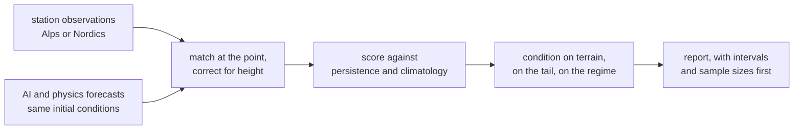

# complex-terrain-verif

Station verification of open AI weather forecasts in complex terrain. Data-driven models are trained and scored against gridded reanalysis, which is a smoothed estimate of the atmosphere and is also their training data. A 0.25 degree grid, about 28 km, cannot resolve the valley a station stands in. This repository measures the size of that gap where it should be largest: the Alps first, the Nordics second.

One sentence claim: on this window and these stations, here is how the models differ, with intervals, and here is what that does not tell you.

## Two domains

| Domain | Centre | Observations | Credential | Archive |
|---|---|---|---|---|
| `alps` | Switzerland, with the French, Italian and German Alpine stations to follow | MeteoSwiss PeakWeather, 302 SwissMetNet stations with terrain descriptors from a 50 m elevation model | none | 2017 onwards, served as a dataset |
| `nordics` | Norway, reaching to Iceland, Sweden and Denmark | MET Norway Frost, with SMHI and the others as each is confirmed | `FROST_CLIENT_ID` | live API, about four days of open forecasts |

Austria is out of scope. The two domains share one pipeline: a source produces the station table and the observation table, and nothing downstream knows which country it came from.

## Why this exists

- Headline results are verified against reanalysis. Against station observations, errors are substantially larger. This repository verifies against stations only.
- Models trained on a squared error drift toward the conditional mean and win on root mean square error while losing realism, so every skill table here is paired with a variance-ratio and field-activity diagnostic.
- In complex terrain the error that matters is not the mean one. A valley under a winter inversion and a ridge in a Foehn are the cases a smoothed orography cannot represent, and they are the cases this design conditions on: by terrain class, by the observed tail, and by the circulation regime of the day.
- The matched table is written as a parquet with a content hash, so a post-processing model can be trained on it later without touching the plumbing.

## What is in the box

```
src/afv/          match, baselines, dataset, scores, diagnostics, verif_bridge, report, diff,
                  cli, fixtures, schema, config
src/afv/sources/  one module per observation network behind one interface:
                  peakweather (Switzerland), frost (Norway)
configs/          alps.yaml, default.yaml (Nordic), fixtures.yaml (offline CI)
notebooks/        00 bootstrap, 01 fetch, 02 build dataset, 03 verify, 04 report, 05 inference
docs/             METHODOLOGY, DIAGRAMS, BENCHMARKS, RELATED_WORK,
                  WHAT_THIS_DOES_NOT_SHOW, DEPLOY, figures/
tools/            make_doc_figures.py, which regenerates every image in the docs
data/             DATASHEET, static station lists, cache (gitignored)
tests/            59 offline tests; network tests deselected by default
```

## Design, at a glance

Eight Mermaid views in [docs/DIAGRAMS.md](docs/DIAGRAMS.md), rendered by GitHub with no
toolchain: the two-domain architecture, the run as a sequence, the data contracts and the
source interface as class diagrams, two decision trees (whether a variable may be scored
at all, and how a forecast is brought down to a station), the stack with each external
project's licence, and the states a cached download is allowed to be in.

What is measured, and the metric definitions, are in
[docs/BENCHMARKS.md](docs/BENCHMARKS.md), together with the synthetic fixture run that
demonstrates the pipeline end to end. No learned nowcasting model is implemented here and
[docs/NOWCASTING.md](docs/NOWCASTING.md) says so plainly, with the architecture one would
need and the three preconditions before it would be worth adding; the only nowcast in the
repository is persistence, and it is a baseline.



## 60-second offline quickstart, no credentials and no downloads

```
pip install -e ".[dev]"
afv sources
afv fixtures --out data/fixtures
afv match  --config configs/fixtures.yaml
afv score  --config configs/fixtures.yaml
afv diag   --config configs/fixtures.yaml
afv report --config configs/fixtures.yaml
pytest -q
```

`afv sources` prints what each domain serves and what it refuses, with the reason. The fixture world is synthetic: a smoothed, slowly warming fake AI model and a sharp, noisier fake physics model. Its numbers mean nothing about the real models; they exist so the pipeline is testable end to end.

## Running the Alpine domain

No credential is needed, because the observations are a published dataset rather than an API.

```
pip install -e ".[alps]"
afv stations --config configs/alps.yaml
afv obs      --config configs/alps.yaml
afv fetch    --config configs/alps.yaml
afv match    --config configs/alps.yaml
afv score    --config configs/alps.yaml
afv report   --config configs/alps.yaml
```

`afv stations` downloads two small metadata files and writes a station table that carries slope, aspect, terrain ruggedness and the difference between the station height and the elevation model, because the claim being tested is that error depends on terrain. The first `afv obs` downloads the observation years, which is several hundred megabytes each.

## Running the Nordic domain

```
pip install -e ".[grib]"
afv elements
afv stations --config configs/default.yaml
afv obs      --config configs/default.yaml
afv fetch    --config configs/default.yaml
```

A Frost client id goes in `.env` as `FROST_CLIENT_ID`, with `AFV_USER_AGENT` beside it. Open forecast data is retained for about four days, so this domain accumulates its archive one day at a time. GRIB decoding on Windows is in [docs/DEPLOY.md](docs/DEPLOY.md); the short version is that ecCodes is a C library and conda-forge is the reliable route, which is what `pixi.toml` is for.

## Self-hosting

A scored run can be served over HTTP, read-only, on a laptop and with no GPU:

```
pip install -e ".[server]"
afv serve --root results
```

or `docker compose up -d`, which binds to the loopback address, mounts the results
read-only, drops every capability and runs as a non-root user. The service returns score
tables, the station list, the manifest, the report and the figures as JSON and files; it
runs no model, fetches nothing and has no write path. Queries go through DuckDB when it is
installed and pandas when it is not, and a test asserts the two agree.

[docs/SERVING.md](docs/SERVING.md) has the routes, the two sane ways to expose it, and an
honest ladder of what a fuller weather server would add at each step and what hardware
each step needs. Running a model locally is step three on that ladder and is not
implemented here, for a reason the page states.

## Results

Results appear under `results/<config name>/`: `matched.parquet`, `scores.parquet`, `report.md`, `figures/`. Every table caption carries the sample size, the interpolation method and the lapse flag.

**No real results yet.** This section is filled only from a run against real forecasts and real observations, and it will state the evaluation period, the station count and the number of paired values before it states any score.

## What this does not show

One window and one season; a few dozen stations carrying representativeness error of their own; raw model output rather than a post-processed product; a 0.25 degree global field interpolated to a point, which the lapse correction improves and does not repair; sub-grid processes such as a channelled Foehn or a decoupled boundary layer, which are invisible at this resolution by construction; and an overlap between the models' training period and the station record that evaluation on recent dates reduces without removing. The full list is in [docs/WHAT_THIS_DOES_NOT_SHOW.md](docs/WHAT_THIS_DOES_NOT_SHOW.md).

## Reproducibility

Every score table carries the dataset hash, which is an order-independent content hash of the matched parquet, plus the config hash and the package version. Cached downloads have sha256 manifests. The same sample is used for every compared model.

## Related work this stands on

This repository is an integration, not an invention. The quality control, the elevation-aware downscaling, the metrics, the blocking index and the Swiss observations are all other people's work, named with their licences in [docs/RELATED_WORK.md](docs/RELATED_WORK.md). What is new here is the combination: station-level verification in complex terrain, conditioned on terrain and on circulation, across two mountain and high-latitude domains.

## Licence and citation

Apache-2.0. Cite with [CITATION.cff](CITATION.cff). The data carry their providers' terms: ECMWF open data under CC BY 4.0, MeteoSwiss PeakWeather under BSD-3-Clause, MET Norway Frost under CC BY 4.0.
