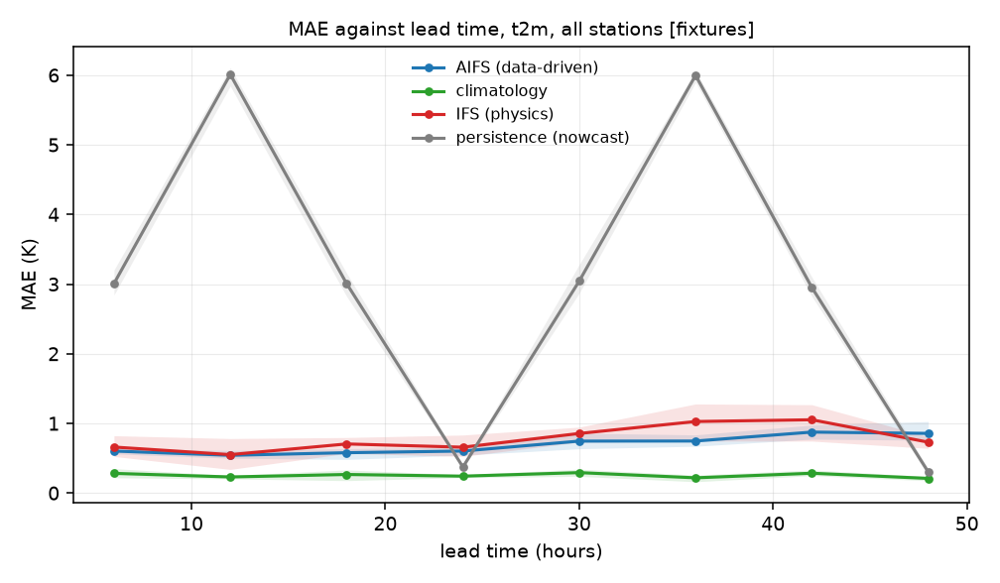
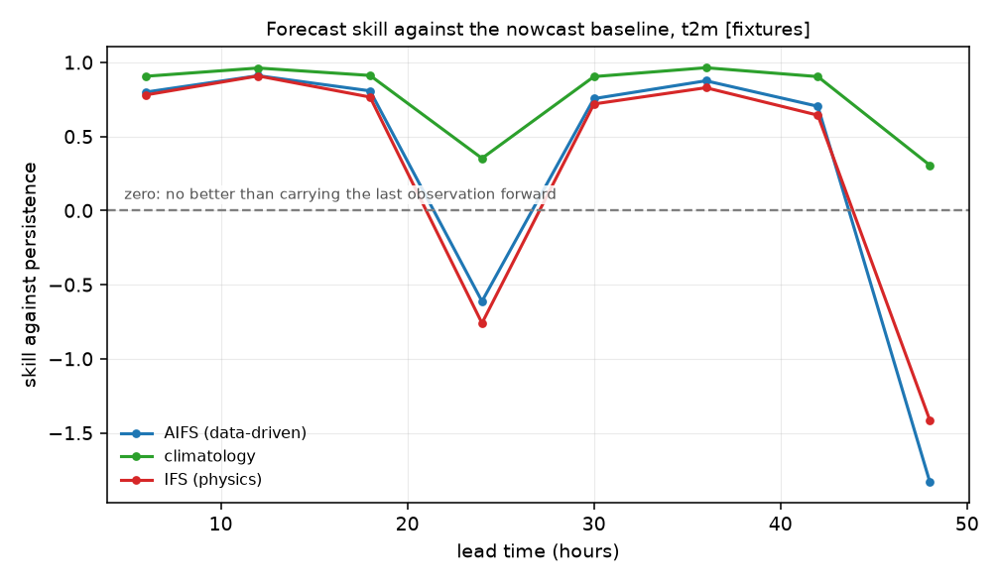
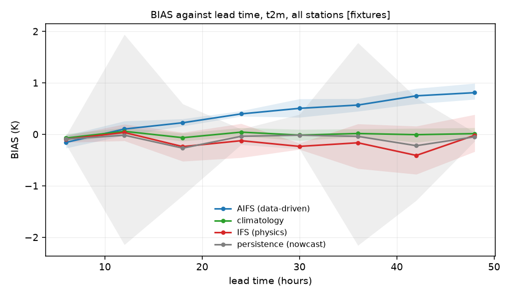

# Benchmarks

What is measured, against what, and how to tell a result from a demonstration.

**There are no real results in this repository yet.** Everything below the first two
sections is the synthetic fixture world, which exists so the pipeline can be exercised end
to end with no network and no credentials. Its numbers say nothing whatever about AIFS,
IFS or any other model. When a real run exists, it appears in its own section with the
period, the station count and the number of paired values stated before any score.

## What is scored

| Metric | Definition | Reads as |
|---|---|---|
| bias | mean of forecast minus observation | systematic error, with its sign |
| MAE | mean absolute error | typical error, robust to outliers |
| RMSE | root mean square error | typical error, punishes large misses |
| skill against a baseline | 1 minus the model's MAE divided by the baseline's | whether the forecast is worth having |
| variance ratio | standard deviation of the forecast over that of the observation | realism: below one means smoothed |
| field activity | spatial variance of the field against lead time | realism, independent of the stations |
| quantile-quantile | forecast quantiles against observed | where in the distribution the error sits |
| tail-conditional error | the same scores above the 90th percentile | whether the model misses the days that matter |

Every score carries a block-bootstrap interval, blocked by day so that errors within a day
stay together, and the sample size. Two models are only compared on rows where both and
the observation exist, which shrinks the sample and is recorded in the manifest.

## The baselines, and where nowcasting ends

A forecast is only interesting relative to something cheaper. Two cheap things are
computed for every run:

- **Persistence**, the observation at initialisation carried forward. This is the simplest
  nowcast there is, and at short lead times it is hard to beat. The lead time at which a
  model overtakes it is the honest boundary between the nowcasting range and the
  forecasting range.
- **Climatology**, the mean by station and hour of day over the window. Beating it is the
  minimum any forecast must do.

A richer nowcast, optical-flow advection of radar for example, is not in this repository
and is not planned: the subject here is verification of forecasts, and persistence is the
baseline that makes the forecasting claim meaningful. Saying so is cheaper than pretending
otherwise.

## The fixture benchmark, which is synthetic

The fixture world has a known truth field: smooth, linear in latitude and longitude, with
a diurnal cycle. Two fake models sample it. One is deliberately smoothed and slightly
biased, standing in for the blurring that squared-error training produces; the other is
sharper and noisier. Observations are truth at the station points plus noise, with one
quality-flagged hour and one gap per station.

Four stations, eight initialisations, lead times 6 to 48 hours, 31 paired values per lead.

**Mean absolute error, 2 m temperature, kelvin, all stations:**

| lead (h) | AIFS (fake, smoothed) | IFS (fake, sharp) | persistence | climatology |
|---|---|---|---|---|
| 6 | 0.603 | 0.660 | 3.007 | 0.282 |
| 12 | 0.541 | 0.551 | 6.011 | 0.231 |
| 18 | 0.579 | 0.705 | 3.007 | 0.266 |
| 24 | 0.603 | 0.658 | **0.374** | 0.242 |
| 36 | 0.746 | 1.027 | 5.997 | 0.218 |
| 48 | 0.856 | 0.730 | **0.302** | 0.210 |





**Read the sawtooth before reading anything else into it.** Persistence collapses to almost
no error at exactly 24 and 48 hours, and is worst at 12 and 36. That is correct and it is
the fixture world telling the truth about itself: its signal is a pure diurnal cycle, so
carrying an observation forward by a whole number of days is nearly perfect, and carrying
it forward by half a day is as wrong as possible. Climatology wins everywhere for the same
reason, because a climatology by hour of day *is* the fixture's signal. Real stations do
not behave like this, which is exactly why these numbers are not a result.

What the figures do establish is that the pipeline computes what it claims to: the
intervals are present, the sample sizes are equal across models, and the baselines behave
the way the construction of the world says they must.



## The realism diagnostic, which is the point of pairing it with the scores

A model trained on squared error drifts toward the conditional mean: it wins on error and
loses the variability of the real atmosphere. A score alone cannot see that. The variance
ratio can, and in the fixture world it correctly separates the two fake models:

| model | variable | variance ratio, 6 to 48 h | what it says |
|---|---|---|---|
| AIFS (fake, smoothed) | t2m | 0.82 to 0.98 | under-dispersive, as constructed |
| IFS (fake, sharp) | t2m | 0.96 to 1.12 | about right |
| IFS (fake, sharp) | ws10 | 1.25 to 2.18 | over-dispersive, as constructed |
| climatology | t2m | 0.96 to 1.00 | matches by construction |

The diagnostic recovers the design of the synthetic world without being told it. That is
the strongest claim this repository can honestly make before a real run.

## Reproduce every number on this page

```
pip install -e ".[dev]"
afv fixtures --out data/fixtures
afv match  --config configs/fixtures.yaml
afv score  --config configs/fixtures.yaml
afv diag   --config configs/fixtures.yaml
python tools/make_doc_figures.py
```

The figures are regenerated by that last command from `results/fixtures/scores.parquet`
and are never drawn by hand. To produce the same page for a real run, point it at that
run's directory: `python tools/make_doc_figures.py --results results/alps --tag alps`.

## Real results

Not yet. This section will state, in this order and before any score: the evaluation
period, the number of stations, the number of paired values, the quality-control rejection
rate, the model versions and their training cut-off dates. Then the tables, each with its
interval, and then the limitations in
[WHAT_THIS_DOES_NOT_SHOW.md](WHAT_THIS_DOES_NOT_SHOW.md).
