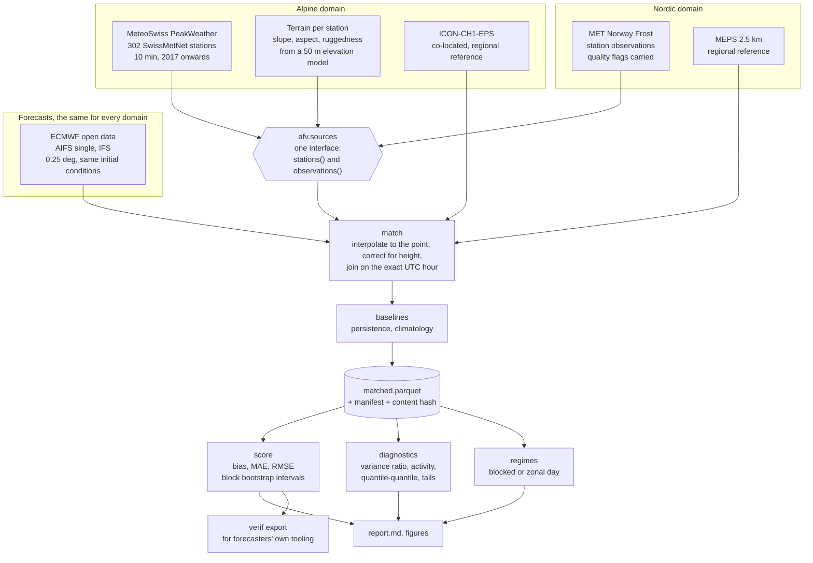
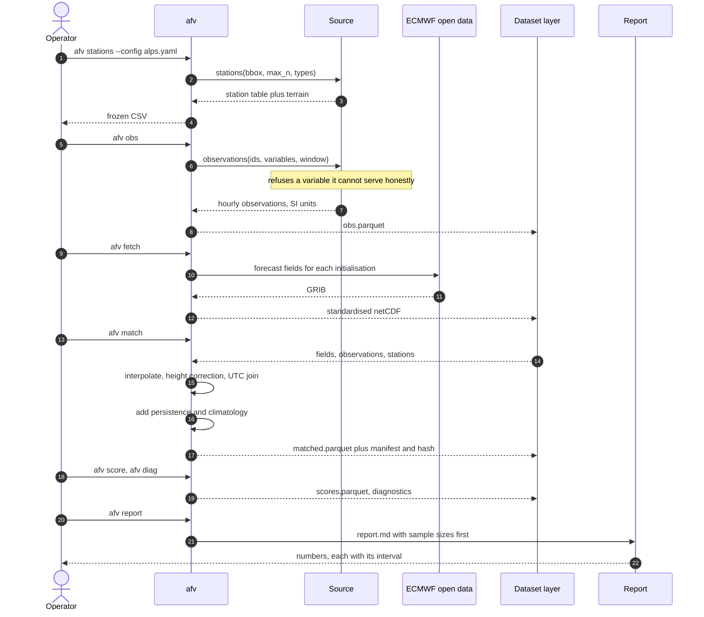
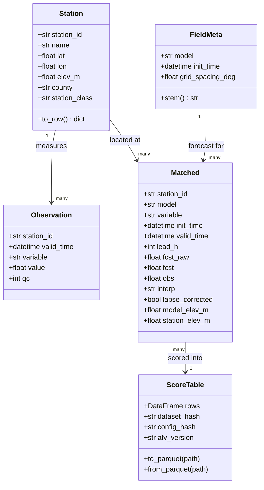
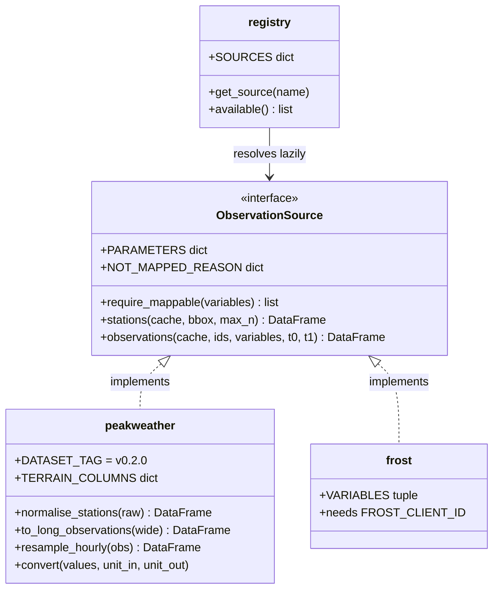
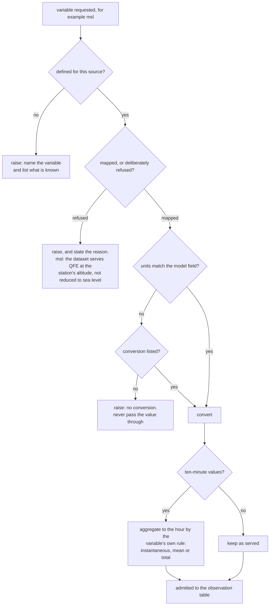
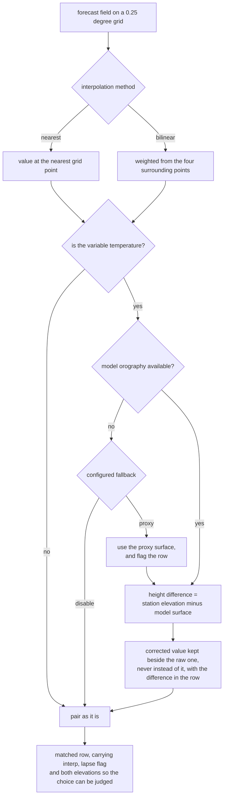
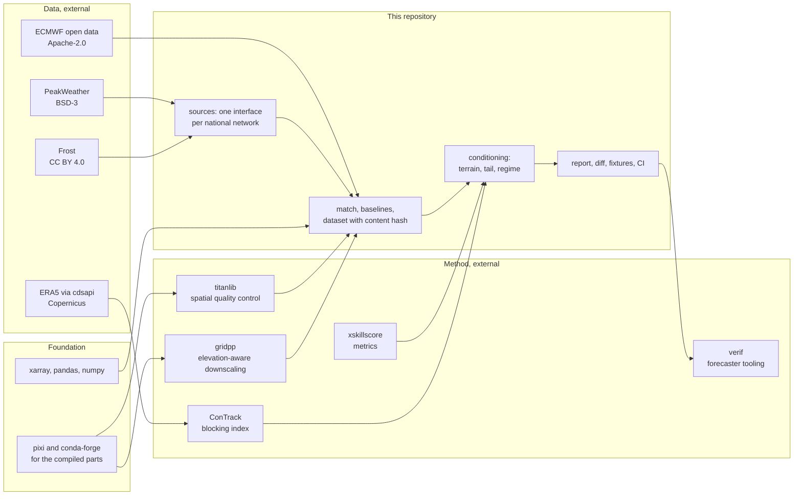
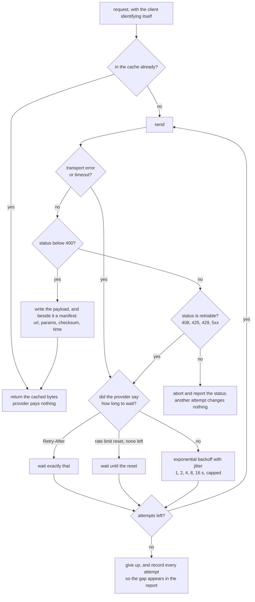
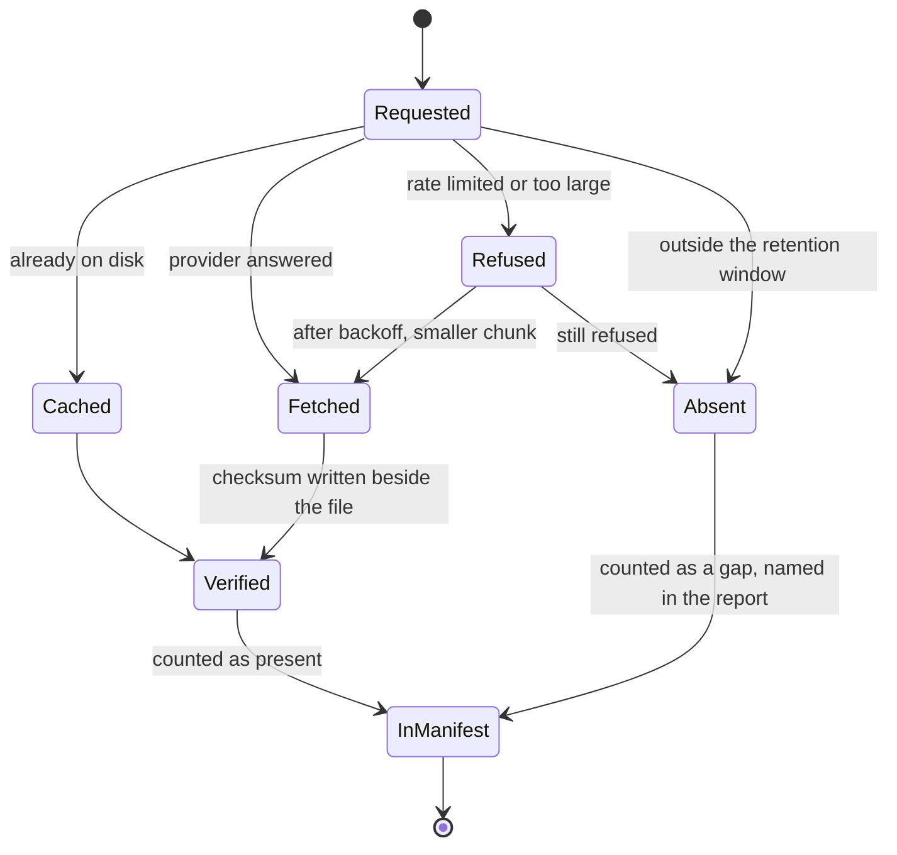

# Diagrams

Mermaid, which GitHub renders from the Markdown itself, so there is no build step, no
generated image to go stale, and no toolchain to install before a reader can see the
design. Seven views: architecture, the run, the data contracts, the source interface, two
decision trees, and the stack with its licences.

## 1. Architecture: two domains, one pipeline

The point of the design is the join in the middle. Everything above it is national and
particular; everything below it is the same code whatever country the rows came from.

## 2. The run, in order

Two phases, and the separation matters: everything after the fetch is repeatable offline,
which is why continuous integration can exercise the whole pipeline with no credentials.

## 3. Data contracts

Four tables and one rule: a module may only produce or consume these shapes. The validator
raises on a missing column or a wrong dtype rather than letting a string reach a numeric
column and surface later as a strange score.

## 4. The source interface

Adding a country is this much work: one module with two functions and a row in the
registry. Nothing downstream changes, which is the whole reason the interface exists.

## 5. Decision tree: may this variable be scored in this domain?

The branch that matters is the third one. A quantity with the same name in two places is
not necessarily the same quantity, and the cost of assuming it is tends to be a large,
confident and wrong number rather than a crash.

## 6. Decision tree: how a forecast is brought to a station

## 7. The stack, and who wrote which part

Boxes outside the dashed group are other people's work. The repository's own contribution
is the join between them, and the conditioning on terrain and circulation.

## 8. One request, and what the client does with the answer

National services publish hard limits and say, in the response, how long to wait. The
rule that matters is the split on the right: a status that can succeed later is worth
another attempt, and a status that is the provider's final answer is not. Retrying a 404
spends someone's quota to be told the same thing twice.

The jitter is not decoration. Several clients backing off on the same curve return at the
same moment and recreate the burst that caused the refusal.

## 9. What a cached download is allowed to be

A gap in the archive is a fact about the archive, so it is recorded rather than quietly
closed. The report reads the manifest, which is why a shrinking sample shows up in the
output instead of hiding in it.

