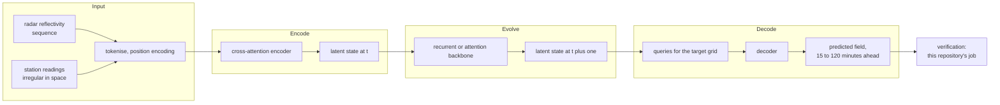

# Nowcasting

**Not implemented here, and the reason is worth stating rather than leaving as a silence.**

This repository verifies forecasts. It does not produce them, and it does not train a
model. The only nowcast in it is **persistence**, the last observation carried forward,
which is computed for every run as a baseline. That is deliberate: a forecast is only
interesting relative to something cheap, and the lead time at which a model overtakes
persistence is the honest boundary between the nowcasting range and the forecasting range.
That crossover is plotted in [BENCHMARKS.md](BENCHMARKS.md).

What follows is the architecture a real nowcasting component would need, recorded so that
the boundary of this repository is explicit and so that the work is scoped rather than
hand-waved. Nothing below is in the code.

## What a learned nowcasting pipeline looks like

The published designs for 15 to 120 minute horizons encode radar and station fields into a
latent space, evolve that latent state with a recurrent or attention backbone, and decode
back onto a target grid. Convolutional recurrent networks, U-Nets and cross-attention
encoders are the usual building blocks.

The loss usually combines an absolute error term with a temporal-difference term, because
optimising absolute error alone produces the same smoothing that this repository exists to
detect: a blurred prediction scores well and shows no cells.

## Why it is not here

1. **It is a different project.** Training a spatiotemporal model needs radar archives, a
   GPU and weeks. Verification needs neither. Mixing them would mean this repository could
   not be run by anyone without both.
2. **Nothing could be claimed from it yet.** An untrained scaffold is not a nowcast. A
   model architecture committed without data, training or scores would be the same defect
   as a result with no run behind it.
3. **The verification side is the scarcer half.** There are many nowcasting models and few
   honest station-level evaluations of them in complex terrain. This repository is on the
   side with less competition and more value.

## What would make it worth adding

In order, each a precondition for the next:

- A radar archive for at least one domain. MeteoSwiss publishes radar composites; access
  and licensing would have to be checked first.
- A target that is not already solved by persistence at the lead times in question, which
  for temperature at hourly resolution it largely is. Precipitation is the honest target,
  and it is the hardest.
- An evaluation protocol that is already in this repository, so the model is scored the
  same way as everything else rather than on its own terms.

Until those hold, the nowcasting content of this repository is one baseline, computed
correctly and reported next to everything it is compared against.
