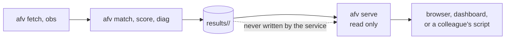

# Serving the results: self-hosting, and the ladder beyond it

This repository can be self-hosted. What that means precisely, and what it does not mean,
is the first section, because "AI weather server" is a phrase that covers two very
different machines.

## What is implemented

**A read-only service over results already computed.** It serves score tables, the station
list, the run manifest, the report and the figures, from a results directory produced
offline by `afv match` and `afv score`. It runs on a laptop, needs no GPU, no credentials
and no network access of its own, and has no write path at all.

```
pip install -e ".[server]"
afv serve --root results
```

Then `http://127.0.0.1:8000/health`, and the interactive documentation at
`http://127.0.0.1:8000/docs`.

| Route | Returns |
|---|---|
| `GET /health` | version, results root, whether it exists, which query engine is active |
| `GET /sources` | what each observation source serves, and what it refuses with the reason |
| `GET /runs` | the runs present, and what each one has |
| `GET /runs/{run}/scores` | score rows, filtered by variable, model, metric, stratum, lead |
| `GET /runs/{run}/manifest` | dataset hash, row count, station count, period |
| `GET /runs/{run}/stations` | the stations in that run |
| `GET /runs/{run}/report` | the run's report as Markdown |
| `GET /runs/{run}/figures/{name}` | a figure from that run |

Queries go through DuckDB when it is installed, which reads parquet without loading it and
matters once a run reaches millions of rows, and through pandas when it is not. A test
asserts the two return the same rows, because an optional accelerator that quietly answers
differently is worse than no accelerator.

### In a container

```
docker compose up -d
```

The compose file binds the service to the loopback address, mounts the results directory
read-only, drops every capability, runs as a non-root user and makes the root filesystem
read-only. None of that is decoration: a service with no write path should not be able to
acquire one because somebody later added a volume.

### Exposing it, if you must

The service is loopback-only by default and nothing changes that by accident. Two ways to
reach it from elsewhere, in order of preference:

1. **A tunnel initiated from the inside.** The daemon makes an outbound connection to an
   edge network, which then routes a name to it. The local firewall can refuse every
   inbound packet, so scanning the home address finds nothing. This is the right answer
   for a residential connection.
2. **A reverse proxy on a machine that is already exposed**, terminating TLS, with the
   service reachable only on a private network behind it.

**Not** forwarding a router port to a home network. That publishes the whole subnet's
attack surface to acquire one read-only endpoint.

Whichever is used, note what is being published: a station network, a model comparison and
a set of scores. Check the providers' terms before republishing their data. ECMWF open data
and MET Norway Frost are CC BY 4.0; the MeteoSwiss dataset is BSD-3-Clause; attribution is
required in each case, and the licences are listed in [RELATED_WORK.md](RELATED_WORK.md).

## What is not implemented, and what each step would need

The question behind "self-hosted AI weather server" is usually about running the models
rather than serving the results. That is a different machine and a different project, and
pretending otherwise in a repository that cannot do it would be the same defect as a result
with no run behind it. The honest ladder:

| Step | What it adds | What it needs | State here |
|---|---|---|---|
| 1. Serve results | Scores, reports and figures over HTTP | A laptop | **Implemented** |
| 2. Scheduled archive | A daily fetch so the open-data window never lapses | A machine that stays on, or a hosted scheduler | Possible today with `afv fetch` under cron; not wired |
| 3. Run an AI model locally | Forecasts of your own rather than the published ones | A GPU with 16 GB or more, tens of GB of weights and initial conditions | Not implemented. `notebooks/05` runs one on a hosted T4, which is the realistic route without buying hardware |
| 4. Convective nowcasting | 15 to 120 minute prediction from radar | A radar archive, a GPU, and a training budget | Not implemented, and scoped in [NOWCASTING.md](NOWCASTING.md) |
| 5. An interactive map | Particle and vector rendering in a browser | A frontend project and a tile pipeline | Not implemented. The service returns JSON, which is the part a frontend would need |
| 6. Agentic question answering over the results | Ask a question, get the number and its provenance | A served model and a retrieval index | Not implemented |
| 7. Cluster scaling | Many runs, many domains, in parallel | A scheduler and a cluster | Not implemented, and the repository is not the bottleneck at this size |

Steps 3 and 4 are the ones worth being explicit about. A verification repository that also
trained models would be unrunnable by anyone without a GPU, and its verification claims
would be about its own model, which is the circularity the whole design exists to avoid.
Keeping the two apart is deliberate: this side stays cheap to run and independent of what
it scores.

## Where the service fits in the workflow



Everything to the left of the results directory happens offline, on a schedule or by hand.
The service only reads. That boundary is what lets it run with no credentials and makes it
safe to expose a single endpoint rather than a toolchain.
